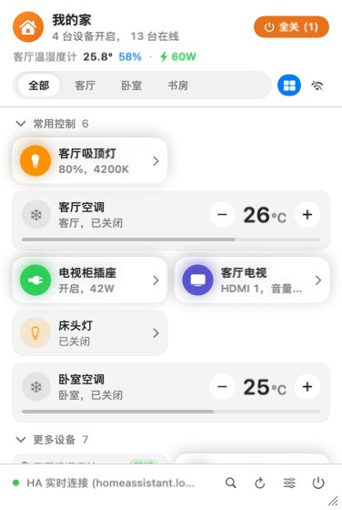
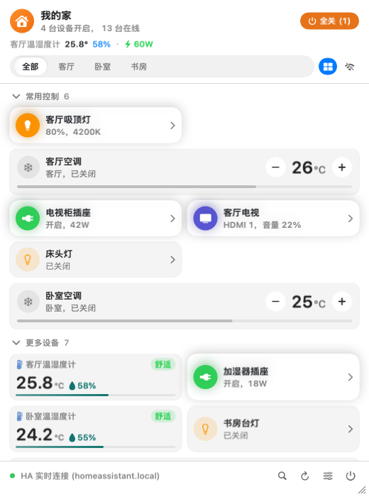

English | [简体中文](README.zh-CN.md)

# MenuBarMijia · Personal macOS Build

**Control your smart home from the Mac menu bar.**

Connect through Xiaomi Cloud QR login or your own Home Assistant, find devices by name or pinyin, and adjust them with native cards and keyboard shortcuts. Resize the panel to suit your desktop; its dimensions are remembered.

macOS 14+ · Swift 6 · Apple Silicon & Intel · MIT

<p align="center">
  
</p>

*Current interface shown with built-in demo devices.*

This fork is maintained for personal macOS use. Speech input, natural-language commands, AI services, GrokBall, recommendations and habit learning have been removed. The separate Windows implementation and historical documentation remain in the repository; they do not describe the scope of this macOS build.

## Features

- Switch between Xiaomi Cloud QR login, your own Home Assistant and an offline demo.
- Rooms, favorites, groups, device aliases, ordering and adjustable card sizes. Resize the panel from its edges or bottom-right grip; width and height are remembered.
- Device controls, scenes, quick actions, All Off and button-based undo.
- Name, room, full-pinyin and pinyin-initial search; unmatched sentences never execute commands.
- Temperature/humidity history, energy statistics and device notifications.
- Mac lock/wake and external-display automation rules.
- Typed Shortcuts actions for device toggling, scenes and climate queries.
- Confirmed external actions through `menumijia://toggle?device=<id>` and `menumijia://scene?name=<name>`; the former `ask` route is rejected.

Device capabilities depend on the model and backend. Xiaomi Cloud requires internet access and periodic QR sign-in; general miIO LAN control is not implemented. The two live backends are selected individually, not merged.

<details>
<summary>A wider panel with the same device controls</summary>



</details>

## Keyboard

`⌥M` toggles the panel (customizable). Type or press `⌘F` to search; use `↑`/`↓` to select, Return/Space to toggle, arrow keys for details, Tab to change rooms and Esc to back out. Holding the status item or shortcut does not record audio.

## Upgrading

Old language-created timers are never scheduled or replayed. Their original data remains available in Settings until explicitly cleared, including unreadable archives. Retired assistant preferences and API keys are removed without deleting device credentials, the shared Keychain vault or layout preferences.

Undo is independent of language parsing. Reversible batch actions remain accessible through an undo button for ten minutes after their short banner disappears. Failed undo operations report errors.

## Build and verification

This fork is distributed as source for local builds; it does not use the original Homebrew tap or release updater.

Requires macOS 14+; the package supports Apple Silicon and Intel. Full packaging, including Shortcuts metadata, requires full Xcode.

```bash
bash scripts/check.sh
bash scripts/build_app.sh
```

If the selected developer directory is Command Line Tools, set Xcode for these commands without changing the system selection:

```bash
DEVELOPER_DIR=/Applications/Xcode.app/Contents/Developer bash scripts/check.sh
DEVELOPER_DIR=/Applications/Xcode.app/Contents/Developer bash scripts/build_app.sh
```

For local ad-hoc builds without Shortcuts metadata, the packaging script supports `SKIP_APP_INTENTS=1`. It creates `MenuBarMijia.app` in this checkout and restarts an already-running app of the same name.

This personal build has no update-check UI or background release checks. Rebuild and replace the app manually. The About link points to this fork; local diagnostics no longer direct reports to the original repository. A Quit button sits beside Settings in the panel footer.

## Layout

- `Sources/MenuBarMijiaApp`: SwiftUI/AppKit UI, hotkeys, notifications and Mac automation.
- `Sources/MijiaCore`: devices, providers, structured action execution, undo, history and credentials.
- `Tests`: core, native interaction and snapshot tests; shared device fixtures.
- `windows`: the independent Windows implementation, unchanged by this macOS-only reduction.

See [ADR-0010](docs/adr/0010-macos-explicit-device-control.md) for scope and migration behavior. Historical docs and screenshots can describe removed features. Original attribution and license remain in [LICENSE](LICENSE).
