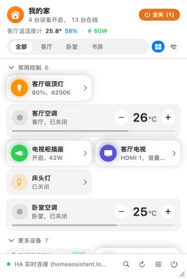
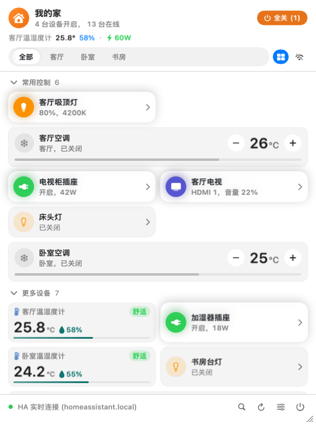

[English](README.md) | 简体中文

# MenuBarMijia · macOS 自用版

**从 Mac 菜单栏，顺手控制家中的设备。**

使用米家 App 扫码，或连接自己的 Home Assistant；通过设备卡片、拼音搜索和键盘快捷键完成日常控制。面板可以自由调整宽高，并自动记住尺寸。

macOS 14+ · Swift 6 · Apple Silicon 与 Intel · MIT

<p align="center">
  
</p>

*截图使用内置演示设备，展示本分支当前界面。*

本 fork 面向 macOS 本机自用维护，已移除文字指令、语音、云端 AI、情绪球、推荐和习惯学习。仓库保留的独立 Windows 实现与历史文档未同步进行这次功能裁剪，其功能描述不代表当前 macOS 版本。

## 保留功能

- 米家云端扫码登录、Home Assistant 或离线演示，三种后端切换使用。
- 按房间浏览，收藏、自定义分组、排序、设备别名和卡片尺寸。面板支持边缘或右下角拖拽缩放，并记住宽高。
- 灯光、空调、风扇、净化器、插座等设备控制；具体能力取决于后端和设备型号。
- 设备名、房间、完整拼音及拼音首字母搜索。
- 场景、批量关闭、快捷动作与撤销；批量操作横幅消失后，十分钟内仍可点击撤销。
- 温湿度历史、电量统计和设备提醒。
- 锁屏、唤醒和外接显示器变化触发的系统自动化。
- 系统快捷指令中的设备切换、场景执行、温湿度查询。
- `menumijia://toggle?device=<id>` 和 `menumijia://scene?name=<name>`；外部控制默认需要确认。

<details>
<summary>查看自由放大后的面板</summary>



</details>

## 使用与连接

macOS 14 及以上，Apple Silicon 或 Intel。

在设置中选择米家云直连并使用米家 App 扫码，或填写自己的 Home Assistant 地址与长期访问令牌。米家控制经小米云中转，需要联网；当前没有通用 miIO 局域网直连。米家会话过期后需要重新扫码。

| 操作 | 按键 |
| --- | --- |
| 呼出 / 收起面板 | 默认 `⌥M`，可自定义 |
| 搜索设备 | 直接输入或 `⌘F` |
| 选择设备 | `↑` / `↓` |
| 开关选中设备 | `Return` / `Space` |
| 展开 / 调节详情 | `→` / `←` |
| 切换房间 | `Tab` / `Shift+Tab` |
| 退出搜索 / 收起 / 关闭 | `Esc` |

长按快捷键或菜单栏图标不会录音；搜索框不会解析控制句。面板右下角设置按钮旁可直接退出应用。

## 从旧版本升级

旧文字定时任务已停止调度，不会自动执行。记录保留在设置中的“旧版定时任务已停用”，可查看并确认清理；不可解析的记录同样保留。

旧助手偏好、习惯和 API Key 会按指定范围清理，不删除设备账号或布局。账号会话、HA Token 和 LG 配对凭据继续存于 macOS 钥匙串。

## 本地构建

本分支提供源码自行构建，不沿用原项目的 Homebrew 安装源或应用内更新渠道。

```bash
bash scripts/check.sh
bash scripts/build_app.sh
```

完整构建（含系统快捷指令元数据）需要完整 Xcode。若默认命令行工具指向 Command Line Tools，可只在命令环境指定 Xcode，无需修改系统设置：

```bash
DEVELOPER_DIR=/Applications/Xcode.app/Contents/Developer bash scripts/check.sh
DEVELOPER_DIR=/Applications/Xcode.app/Contents/Developer bash scripts/build_app.sh
```

仅需本机 ad-hoc 构建且不需要系统快捷指令时，脚本支持 `SKIP_APP_INTENTS=1`。打包脚本会在仓库生成 `MenuBarMijia.app`，并重启原先正在运行的同名应用。

本机版不提供检查更新入口，也不会后台检查原项目发布。更新时重新编译并替换应用。设置中的项目主页指向本 fork，隐私页保留本机诊断，不再引导向原作者反馈。

## 工程结构

- `Sources/MenuBarMijiaApp/`：SwiftUI / AppKit 界面、热键、通知、系统自动化。
- `Sources/MijiaCore/`：设备模型、后端、结构化动作执行、撤销、历史、凭据。
- `Tests/`：Swift 单元测试、原生交互测试、界面快照及共享设备语料。
- `windows/`：保留的独立 Windows 实现；本轮 macOS 功能裁剪没有同步修改 Windows。
- [裁剪决策与升级行为](docs/adr/0010-macos-explicit-device-control.md)。历史文档及旧截图可能描述原版本功能。

许可证和原作者署名见 [LICENSE](LICENSE)。
